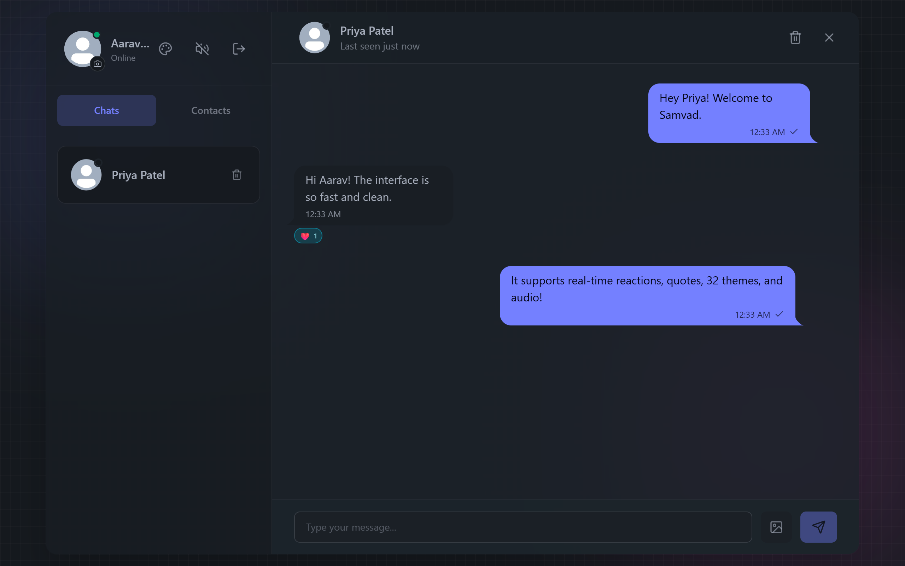
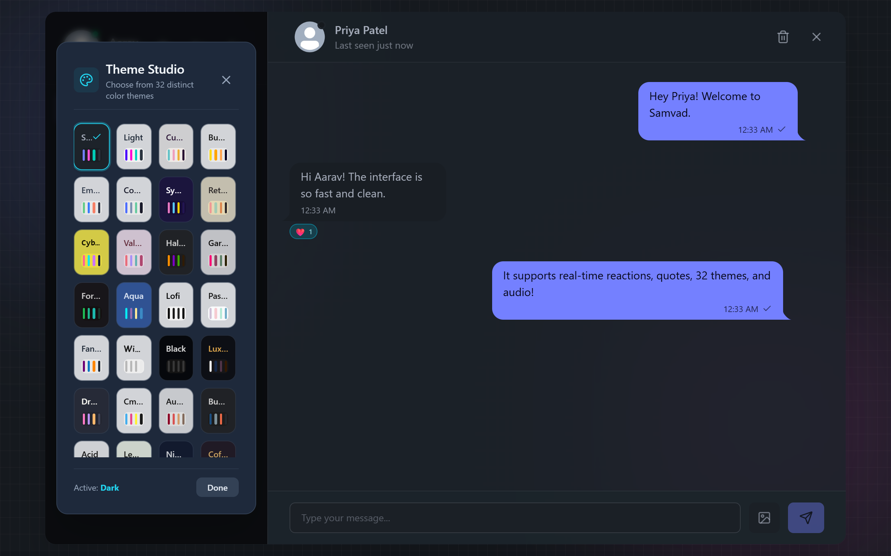
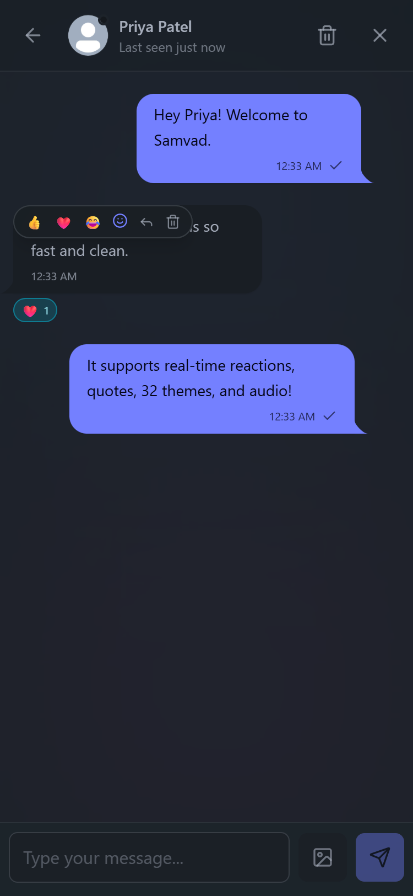
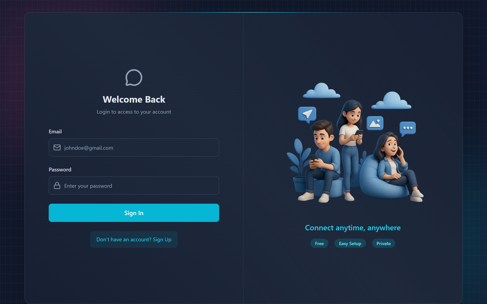
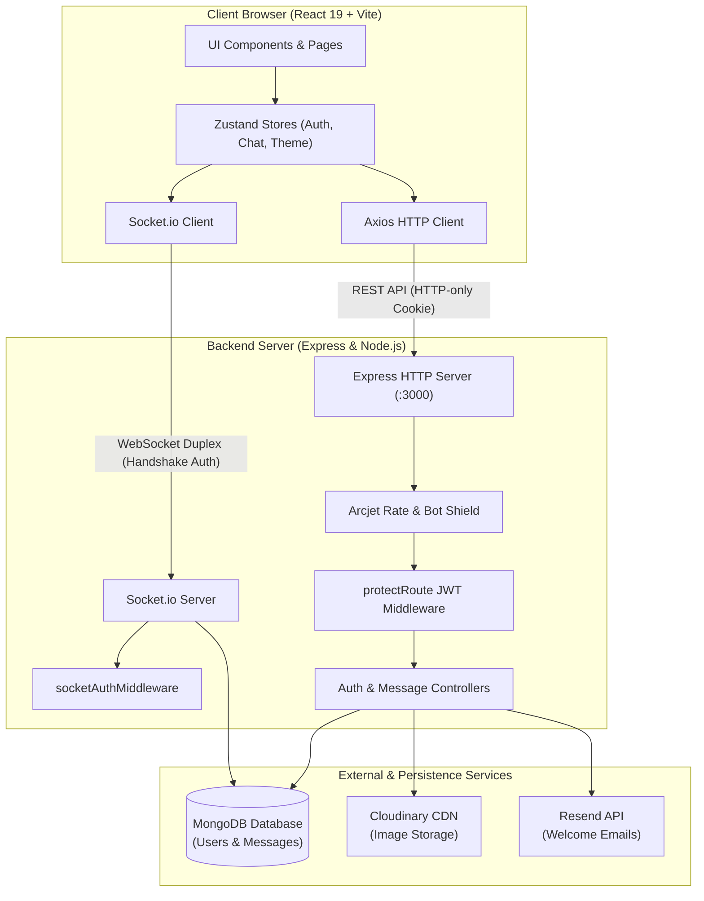
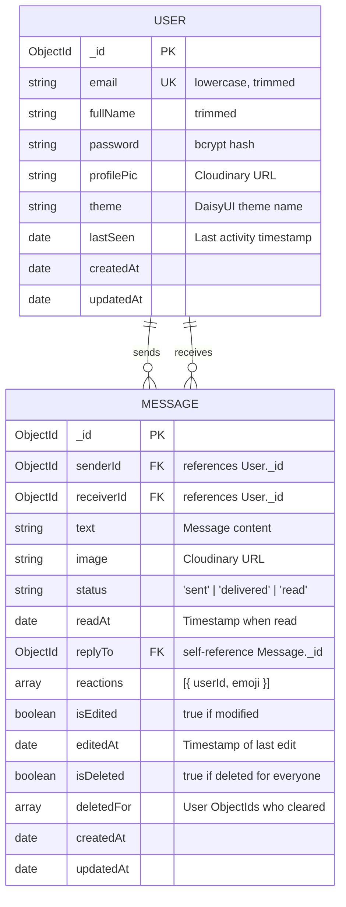

# Samvad (संवाद)

> Full-stack real-time messaging application engineered for fast, private, and resilient communication across desktop, tablet, and mobile devices.


[Live Backend Service](https://chatify-live-backend.onrender.com/healthz) &bull; [GitHub Repository](https://github.com/Realadityapathak/Chat-App) &bull; [Quick Start](#getting-started) &bull; [API Reference](#api-reference) &bull; [Architecture](#architecture)

---

## Preview

| Desktop Chat Interface (1280px) | Theme Studio (32 Palettes) |
| :---: | :---: |
|  |  |
| *Real-time chat viewport with reactions, replies, and status* | *Theme picker with active swatch previews and persistence* |

| Mobile Conversation List (375px) | Mobile Chat View (375px) | Authentication Portal |
| :---: | :---: | :---: |
|  |  |  |
| *Adaptive single-pane sidebar with unread badges* | *Decoupled scrolling with Back navigation* | *Responsive auth card with bot protection* |

---

## Table of Contents

- [About](#about)
- [Features](#features)
- [Tech Stack](#tech-stack)
- [Architecture](#architecture)
- [Project Structure](#project-structure)
- [Getting Started](#getting-started)
- [Environment Variables](#environment-variables)
- [Available Scripts](#available-scripts)
- [API Reference](#api-reference)
- [Database Schema](#database-schema)
- [Security](#security)
- [Performance and Accessibility](#performance-and-accessibility)
- [Testing](#testing)
- [Deployment](#deployment)
- [Troubleshooting](#troubleshooting)
- [Roadmap](#roadmap)
- [Contributing](#contributing)
- [Author and Acknowledgements](#author-and-acknowledgements)

---

## About

Samvad (derived from the Sanskrit word *संवाद*, meaning harmonious dialogue) is a production-grade messaging platform designed to provide instant, distraction-free communication across desktop and mobile browsers. It resolves the common latency and state-drift pitfalls of real-time web applications by combining WebSocket event streaming with database durability, multi-device presence synchronization, and optimistic UI rendering. Whether used for personal conversations or community messaging, Samvad ensures privacy, intuitive ergonomics, and consistent cross-platform responsiveness.

---

## Features

### 1. Messaging & Collaboration
- **Direct Messaging**: 1-on-1 conversations with text and photo attachments.
- **Media Uploads**: Base64 image uploads hosted on Cloudinary CDN with client-side file size guards (up to 5MB binary / 10MB HTTP payload).
- **Quoted Replies**: Interactive reply pill inside message bubbles with one-click smooth scrolling to the original quoted message.
- **Emoji Reactions**: Interactive emoji toolbar (`👍`, `❤️`, `😂`, `😮`, `😢`, `🔥`) with aggregated counter badges under message bubbles.
- **Message Editing**: Sender-only editing with automatic `isEdited` flag and edited timestamp synchronization.
- **Dual Deletion Modes**: Flexible deletion supporting "Delete for me" (personal thread filtering) or "Delete for everyone" (soft deletion with broadcast).
- **Clear Conversations**: Full conversation clearing with server-side `$addToSet` aggregation filtering.

### 2. Real-Time Presence & Interaction
- **WebSocket Synchronization**: Powered by Socket.io with handshake cookie authentication.
- **Dynamic Typing Indicators**: Debounced real-time typing indicators in chat headers, sidebar lists, and animated chat bubbles.
- **Delivery & Read Receipts**: Visual status checkmarks transitioning from single check (`sent`), to double check (`delivered`), to cyan double check (`read`).
- **Unread Message Badges**: MongoDB aggregation calculating precise unread counters per partner, updated optimistically on new messages.
- **Granular Last Seen Tracking**: Presence monitoring broadcasting relative offline timestamps (`"just now"`, `"Xm ago"`, `"yesterday at [time]"`, `"more than 1 month ago"`).
- **Global Lifecycle Listeners**: Persistent WebSocket event listeners active across all views, ensuring notification sounds and badges trigger even when no conversation is actively selected.

### 3. Accounts & Personalization
- **Theme Studio**: 32 DaisyUI themes (`dark`, `light`, `synthwave`, `cyberpunk`, `retro`, `dracula`, `nord`, etc.) with 4-swatch preview indicators.
- **Account-Level Persistence**: Selected theme persists directly in the user document and restores automatically upon login across devices.
- **Audio Feedback**: Pre-instantiated mechanical keystroke audio and message arrival notification sounds with global mute toggles.
- **Profile Management**: Avatar customization with instant camera badge upload triggers and confirmation dialogs.

### 4. UI/UX & Responsive Engineering
- **Mobile-First Breakpoint Architecture**: Adaptive layout displaying a full-bleed single-pane view on mobile screens (`< 768px`) with Back button navigation, scaling into a side-by-side split view on tablets and desktops (`≥ 768px`).
- **Scroll Decoupling**: Sticky pinned headers and input bars bounded with `shrink-0`, while message threads utilize isolated `min-h-0 overflow-y-auto` scrolling.
- **Safe-Area Protection**: Native mobile notch and home-indicator protection using CSS dynamic viewport units (`100dvh`) and `env(safe-area-inset-bottom)`.

---

## Tech Stack

| Layer | Technology | Version | Purpose |
| :--- | :--- | :--- | :--- |
| **Runtime** | Node.js | `v24.19.0` (`>=20.0.0`) | Backend JavaScript server execution environment |
| **Backend Framework** | Express | `v4.21.2` | REST API routing, JSON body parsing, and middleware pipeline |
| **WebSockets** | Socket.io | `v4.8.1` | Full-duplex bidirectional event transport and user room routing |
| **Database ODM** | Mongoose | `v8.10.1` | MongoDB document modeling, compound indexes, and aggregation |
| **Database** | MongoDB Atlas / Local | `>=6.0.0` | Primary document database storing users and messages |
| **Authentication** | jsonwebtoken | `v9.0.2` | Stateless signed JWT token generation and verification |
| **Password Hashing** | bcryptjs | `v2.4.3` | Cryptographic password hashing (10 salt rounds) |
| **Security / Shield** | `@arcjet/node` & `@arcjet/inspect` | `^1.0.0-beta.10` | Bot detection, attack classification, and rate limiting |
| **Media Hosting** | Cloudinary SDK | `v2.5.1` | Secure image attachment and profile picture hosting CDN |
| **Transactional Email** | Resend | `v6.0.2` | Transactional welcome email delivery with local fallback |
| **Frontend Framework** | React | `v19.1.1` | Declarative component UI rendering |
| **Build Tool / Bundler** | Vite | `v7.1.2` | Rapid ESM development server and Rollup production bundler |
| **Client Routing** | React Router | `v7.8.2` | SPA route management and protected authentication redirects |
| **State Management** | Zustand | `v5.0.3` | Modular lightweight global state stores (`auth`, `chat`, `theme`) |
| **HTTP Client** | Axios | `v1.11.0` | REST communication with credentials and interceptors |
| **WebSocket Client** | Socket.io-client | `v4.8.1` | Real-time WebSocket connection to backend |
| **CSS Styling** | Tailwind CSS | `v3.4.17` | Utility-first mobile-responsive CSS framework |
| **Component UI** | DaisyUI | `v4.12.24` | 32 color themes and styled UI components |
| **Icons** | Lucide React | `v0.542.0` | Crisp SVG action and navigation iconography |
| **Notifications** | React Hot Toast | `v2.6.0` | Accessible feedback toasts and alerts |
| **Code Quality** | ESLint | `v9.33.0` | Static code analysis and React hooks linting |
| **Formatting** | Prettier | `v3.9.10` | Code formatting and style uniformity |

---

## Architecture



### Data Flow Overview

1. **HTTP / REST Flow**:
   - Clients send requests via Axios with `withCredentials: true`.
   - The request traverses `arcjetProtection` (rate limit & bot analysis), followed by `protectRoute` (validating the signed `jwt` cookie).
   - Handlers query or update MongoDB, trigger optional Cloudinary uploads, and respond with clean JSON excluding sensitive fields (`.select("-password")`).

2. **Real-Time WebSocket Flow**:
   - Handshake cookies are extracted and validated against `JWT_SECRET` in `socketAuthMiddleware`.
   - On connection, each socket joins a private room named after the user's ID (`socket.join(userId)`).
   - When a message is sent, the controller persists it in MongoDB and routes `io.to(receiverId).emit("newMessage", message)`.
   - Read receipts, typing indicators, and delivery confirmations stream directly between user rooms without unnecessary global broadcasts.

---

## Project Structure

```
Chat-App/
├── backend/
│   ├── src/
│   │   ├── controllers/
│   │   │   ├── auth.controller.js        # Signup, login, logout, profile update
│   │   │   └── message.controller.js     # Messaging, pagination, reactions, delete
│   │   ├── emails/
│   │   │   ├── emailHandlers.js          # Resend transactional email caller
│   │   │   └── emailTemplates.js         # Responsive HTML email templates
│   │   ├── lib/
│   │   │   ├── arcjet.js                 # Arcjet security initialization
│   │   │   ├── cloudinary.js             # Cloudinary SDK client configuration
│   │   │   ├── db.js                     # MongoDB Mongoose connection handler
│   │   │   ├── env.js                    # Centralized environment variable accessor
│   │   │   ├── resend.js                 # Resend API client configuration
│   │   │   ├── socket.js                 # Socket.io server instance and events
│   │   │   └── utils.js                  # JWT cookie generation helper
│   │   ├── middleware/
│   │   │   ├── arcjet.middleware.js      # Rate limiting and bot protection middleware
│   │   │   ├── auth.middleware.js        # JWT protectRoute HTTP middleware
│   │   │   ├── error.middleware.js       # Centralized 404 & 500 error handlers
│   │   │   └── socket.auth.middleware.js # Socket handshake cookie JWT parser
│   │   ├── models/
│   │   │   ├── Message.js                # Schema with reactions, replyTo, status
│   │   │   └── User.js                   # Schema with bcrypt hash, theme, lastSeen
│   │   ├── routes/
│   │   │   ├── auth.route.js             # Express router for /api/auth
│   │   │   └── message.route.js          # Express router for /api/messages
│   │   └── server.js                     # Express server bootstrap & static serving
│   ├── .env.example                      # Backend environment variable template
│   └── package.json
│
├── frontend/
│   ├── public/                           # Static sound files and favicon
│   ├── src/
│   │   ├── components/
│   │   │   ├── ActiveTabSwitch.jsx       # Switch between Chats and Contacts tabs
│   │   │   ├── BorderAnimatedContainer.jsx # Gradient shell container
│   │   │   ├── ChatContainer.jsx         # Message history, reaction actions, bubbles
│   │   │   ├── ChatHeader.jsx            # Header with presence, typing, last seen
│   │   │   ├── ChatsList.jsx             # Active conversations with unread badges
│   │   │   ├── ContactList.jsx           # All contacts directory
│   │   │   ├── MessageInput.jsx          # Input bar, image preview, quote previews
│   │   │   ├── ProfileHeader.jsx         # User avatar, theme trigger, logout
│   │   │   └── ThemeModal.jsx            # 32-theme selection modal
│   │   ├── hooks/
│   │   │   └── useKeyboardSound.js       # Keystroke audio synthesizer
│   │   ├── lib/
│   │   │   └── axios.js                  # Axios instance with credentials
│   │   ├── pages/
│   │   │   ├── ChatPage.jsx              # Main responsive layout shell
│   │   │   ├── LoginPage.jsx             # Sign in form
│   │   │   └── SignUpPage.jsx            # Registration form
│   │   ├── store/
│   │   │   ├── useAuthStore.js           # Auth state & socket connection lifecycle
│   │   │   ├── useChatStore.js           # Messaging, optimistic UI, reactions
│   │   │   └── useThemeStore.js          # Theme selector & database persistence
│   │   ├── App.jsx                       # Route switcher and theme injector
│   │   ├── index.css                     # Tailwind directives and utility classes
│   │   └── main.jsx                      # React 19 root bootstrap
│   ├── index.html                        # HTML entry point with viewport configuration
│   ├── tailwind.config.js                # Tailwind CSS & 32 DaisyUI themes
│   └── package.json
│
├── docs/                                 # Architectural documentation & screenshots
├── package.json                          # Monorepo root scripts & dev dependencies
└── .gitignore                            # Exclusion rules for secrets & node_modules
```

---

## Getting Started

### Prerequisites

Ensure the following runtimes are installed on your machine:
- **Node.js**: `>=20.0.0` (Verified on `v24.19.0`)
- **npm**: `>=10.0.0` (Verified on `v11.17.0`)
- **MongoDB**: Local MongoDB community service (`mongodb://127.0.0.1:27017`) or a free [MongoDB Atlas](https://www.mongodb.com/atlas) cluster.

---

### Installation

1. **Clone the repository**:
   ```bash
   git clone https://github.com/Realadityapathak/Chat-App.git
   cd Chat-App
   ```

2. **Install all dependencies**:
   ```bash
   npm install
   npm install --prefix backend
   npm install --prefix frontend
   ```

---

### Environment Setup

Create `backend/.env` by copying `backend/.env.example`:

```bash
cp backend/.env.example backend/.env
```

Populate the required configuration variables:

```env
PORT=3000
MONGO_URI=mongodb://127.0.0.1:27017/samvad_db
NODE_ENV=development
JWT_SECRET=your_super_secret_jwt_key_at_least_32_characters
CLIENT_URL=http://localhost:5173

# Optional integrations (App operates with local fallbacks if omitted)
RESEND_API_KEY=
EMAIL_FROM=onboarding@resend.dev
EMAIL_FROM_NAME=Samvad

CLOUDINARY_CLOUD_NAME=
CLOUDINARY_API_KEY=
CLOUDINARY_API_SECRET=

ARCJET_KEY=
ARCJET_ENV=development
```

---

### Running in Development Mode

Run the backend API and frontend client in separate terminal windows:

**Terminal 1 (Backend API & Socket.io server)**:
```bash
npm run dev:backend
# Server starts on http://localhost:3000 with nodemon live reload
```

**Terminal 2 (Frontend Client)**:
```bash
npm run dev:frontend
# Client starts on http://localhost:5173 with Vite HMR
```

Open your browser to `http://localhost:5173`.

---

### Running in Production Mode

To test the compiled production build locally:

```bash
# 1. Build the frontend client bundle
npm run build

# 2. Start the production backend server (serves frontend/dist statically)
npm start
```

Access the application at `http://localhost:3000`.

---

## Environment Variables

### Backend (`backend/.env`)

| Variable | Description | Example / Default | Required |
| :--- | :--- | :--- | :---: |
| `PORT` | Port for Express & Socket.io HTTP server | `3000` | No (Defaults to `3000`) |
| `MONGO_URI` | MongoDB connection string (Local or Atlas) | `mongodb://127.0.0.1:27017/samvad` | **Yes** |
| `NODE_ENV` | Runtime environment (`development` / `production`) | `development` | **Yes** |
| `JWT_SECRET` | Secret key used to sign and verify auth JWTs | `a_secure_random_string_32_chars` | **Yes** |
| `CLIENT_URL` | Frontend origin for CORS and email links | `http://localhost:5173` | **Yes** |
| `RESEND_API_KEY` | Resend API key for transactional welcome emails | `re_123456789` | No (Graceful local fallback) |
| `EMAIL_FROM` | Sender email address for Resend | `onboarding@resend.dev` | No |
| `EMAIL_FROM_NAME`| Sender display name for emails | `Samvad` | No |
| `CLOUDINARY_CLOUD_NAME` | Cloudinary cloud identifier | `my_cloud_name` | No (Images disabled if absent) |
| `CLOUDINARY_API_KEY` | Cloudinary public API key | `123456789012345` | No |
| `CLOUDINARY_API_SECRET` | Cloudinary private API secret | `abcdefghijklmnopqrstuvwxyz` | No |
| `ARCJET_KEY` | Arcjet security API key | `ajkey_...` | No (Local bypass active if absent) |
| `ARCJET_ENV` | Arcjet operating environment mode | `development` | No |

---

## Available Scripts

### Root Workspace (`package.json`)

| Command | Action |
| :--- | :--- |
| `npm run dev:backend` | Starts backend development server (`nodemon backend/src/server.js`) |
| `npm run dev:frontend` | Starts frontend development server (`vite frontend`) |
| `npm run build` | Installs dependencies and compiles frontend bundle into `frontend/dist` |
| `npm start` | Runs backend server in production mode (`node backend/src/server.js`) |
| `npm run lint` | Runs ESLint across frontend and backend JavaScript source files |
| `npm test` | Executes full 13-step end-to-end real-time integration test suite |

### Frontend (`frontend/package.json`)

| Command | Action |
| :--- | :--- |
| `npm run dev --prefix frontend` | Starts Vite dev server with Hot Module Replacement on port `5173` |
| `npm run build --prefix frontend` | Compiles optimized production assets with Rollup |
| `npm run lint --prefix frontend` | Executes ESLint analysis with React Hooks rules |
| `npm run preview --prefix frontend` | Serves the local production build preview |

---

## API Reference

### System & Healthcheck

| Method | Endpoint | Auth Required | Description |
| :--- | :--- | :---: | :--- |
| `GET` | `/healthz` | No | Server uptime, timestamp, and database connection status |

### Authentication (`/api/auth`)

| Method | Endpoint | Auth Required | Request Body | Description |
| :--- | :--- | :---: | :--- | :--- |
| `POST` | `/api/auth/signup` | No | `{ fullName, email, password }` | Registers new user, sets `jwt` cookie, sends welcome email |
| `POST` | `/api/auth/login` | No | `{ email, password }` | Validates credentials, sets `jwt` cookie, returns user data |
| `POST` | `/api/auth/logout` | No | None | Clears `jwt` authentication cookie |
| `PUT` | `/api/auth/update-profile`| **Yes** | `{ profilePic?, theme? }` | Updates profile picture (Cloudinary) or persists theme |
| `GET` | `/api/auth/check` | **Yes** | None | Returns authenticated user object excluding password |

### Messaging (`/api/messages`)

| Method | Endpoint | Auth Required | Parameters / Body | Description |
| :--- | :--- | :---: | :--- | :--- |
| `GET` | `/api/messages/contacts` | **Yes** | None | Returns all registered contacts excluding caller |
| `GET` | `/api/messages/chats` | **Yes** | None | Returns active chat partners with unread counts |
| `GET` | `/api/messages/:id` | **Yes** | `limit?`, `before?` (cursor) | Returns chronological message history with `:id` |
| `POST` | `/api/messages/send/:id` | **Yes** | `{ text?, image?, replyTo? }`| Sends message, saves to DB, emits `newMessage` socket |
| `PUT` | `/api/messages/mark-as-read/:id` | **Yes** | None | Marks messages from `:id` as read, emits `messagesRead` |
| `PUT` | `/api/messages/:id/react`| **Yes** | `{ emoji }` | Toggles reaction on message, emits `messageReaction` |
| `PUT` | `/api/messages/:id/edit` | **Yes** | `{ text }` | Edits message text, marks `isEdited`, emits `messageEdited` |
| `DELETE`| `/api/messages/:id` | **Yes** | `{ deleteType }` (`"everyone"` / `"me"`) | Deletes message for caller or soft-deletes for everyone |
| `DELETE`| `/api/messages/conversations/:id` | **Yes** | None | Clears conversation history with partner `:id` |

---

### Socket.io Real-Time Events

| Event | Direction | Payload | Description |
| :--- | :---: | :--- | :--- |
| `getOnlineUsers` | Server $\rightarrow$ Client | `string[]` (User IDs) | Broadcasts active online user IDs on connect/disconnect |
| `newMessage` | Server $\rightarrow$ Client | `Message` object | Delivers new message to the recipient's private user room |
| `messagesDelivered` | Server $\rightarrow$ Client | `{ receiverId: string }` | Notifies sender that pending messages were delivered |
| `messagesRead` | Server $\rightarrow$ Client | `{ readerId: string, readAt: string }` | Notifies sender that sent messages have been read |
| `typing` | Client $\rightarrow$ Server | `{ to: string }` | Emitted when user types in message input |
| `stopTyping` | Client $\rightarrow$ Server | `{ to: string }` | Emitted when typing ceases or input is cleared |
| `userTyping` | Server $\rightarrow$ Client | `{ from: string }` | Relays typing indicator to recipient's room |
| `userStopTyping` | Server $\rightarrow$ Client | `{ from: string }` | Clears typing indicator for recipient |
| `messageReaction` | Server $\rightarrow$ Client | `{ messageId, reactions: [] }` | Broadcasts updated emoji reactions to both participants |
| `messageEdited` | Server $\rightarrow$ Client | `Message` object | Broadcasts edited message payload to both participants |
| `messageDeleted` | Server $\rightarrow$ Client | `{ messageId, deleteType, message }` | Broadcasts message deletion payload to participants |
| `userLastSeen` | Server $\rightarrow$ Client | `{ userId: string, lastSeen: Date }` | Broadcasts updated last seen timestamp on disconnect |

---

## Database Schema



### Database Indexes

To maintain high query speeds as conversation volume grows, Mongoose enforces:
- `users`: `{ email: 1 }` (Unique constraint)
- `messages`: Compound index `{ senderId: 1, receiverId: 1, createdAt: 1 }`
- `messages`: Compound index `{ receiverId: 1, senderId: 1, createdAt: 1 }`

---

## Security

Samvad implements multiple defense-in-depth security layers:

1. **Authentication & Session Protection**:
   - Authentication tokens are signed with HMAC-SHA256 (`jsonwebtoken`) and transmitted exclusively inside `httpOnly`, `SameSite=lax` (or `SameSite=none` with `secure=true` in production) cookies.
   - Cookies are strictly inaccessible to JavaScript execution, neutralizing Cross-Site Scripting (XSS) token theft.
   - Passwords hashed with `bcryptjs` using 10 salt rounds.
   - Passwords explicitly excluded from controller projections using `.select("-password")`.

2. **Bot Detection & Rate Limiting**:
   - Route middleware utilizes `@arcjet/node` to analyze IP reputation, shield against automated bots, and enforce sliding-window rate limits across sensitive endpoints.

3. **Input Sanitization & Injection Defense**:
   - String fields enforce strict type checking (`typeof === "string"`) and `.trim()` normalization before processing, guarding against type confusion attacks.
   - All database lookups validate MongoDB ObjectId structure via `mongoose.Types.ObjectId.isValid()` to prevent NoSQL query injection.
   - Outgoing HTML welcome email templates sanitize dynamic inputs using HTML entity encoding.

4. **Payload Size Enforcement**:
   - Express JSON body parser enforces `limit: "10mb"` to comfortably accept 5MB binary images (~6.7MB Base64) while preventing buffer overflow and memory exhaustion attacks.

5. **Dependency Audit**:
   - Automated `npm audit` reports **0 vulnerabilities** across both frontend and backend dependency trees.

### Reporting a Vulnerability

If you discover a security vulnerability in this project:
1. Open a private security advisory through the repository's **[Security Tab](https://github.com/Realadityapathak/Chat-App/security)** or file an issue labeled `security`.
2. Do not disclose the vulnerability in public forums or pull requests until a patch is released.

---

## Performance and Accessibility

### Measured Performance
- **Client Bundle Size**: Built with Vite in `~5.8s`:
  - `dist/index.html`: `0.47 kB` (gzip: `0.30 kB`)
  - `dist/assets/index.css`: `88.47 kB` (gzip: `17.72 kB`)
  - `dist/assets/index.js`: `393.65 kB` (gzip: `125.43 kB`)
- **Query Optimization**: Replaced unbounded historical message querying with a high-performance MongoDB `$match` $\rightarrow$ `$group` $\rightarrow$ `$lookup` aggregation pipeline.
- **Message Cursor Pagination**: Supports `limit` and `before` query parameters to prevent fetching unbounded records.
- **Audio Allocation**: Single global `Audio` instances avoid dynamic memory reallocation on every keystroke or message.

### Accessibility (a11y) & Ergonomics
- **WCAG 2.1 Touch Targets**: Enforces a minimum 44x44px interactive dimension (`min-h-[44px] min-w-[44px]`) across buttons, icons, tabs, and form controls.
- **iOS Viewport Optimization**: Minimum 16px font size on inputs (`text-[16px] sm:text-sm`) prevents automatic iOS Safari viewport zoom on input focus.
- **Safe Area Insets**: Implements `viewport-fit=cover` and dynamic padding (`env(safe-area-inset-bottom)`) to guarantee notch and gesture bar visibility.
- **Semantic ARIA Attributes**: Includes descriptive `aria-label` attributes on icon-only buttons (`Attach image`, `Send message`, `Remove image`, `Close modal`, `Change profile picture`).

---

## Testing

Samvad includes an automated end-to-end (E2E) integration test runner verifying live HTTP REST routes and Socket.io event delivery simultaneously.

### Running the Test Suite

Make sure the backend server is running (`npm run dev:backend`), then execute:

```bash
npm test
```

### What Is Covered

The 13-step test suite validates:
1. User registration & JWT authentication cookie emission
2. Secondary user creation
3. Bidirectional Socket.io handshake and presence connection
4. Real-time typing indicators (`typing` $\rightarrow$ `userTyping` $\rightarrow$ `userStopTyping`)
5. Message dispatch with automatic `delivered` status calculation
6. Read receipt status transition (`sent` $\rightarrow$ `delivered` $\rightarrow$ `read`) and timestamp persistence
7. Real-time emoji reaction toggling (`messageReaction`)
8. Quoted reply messages with populated parent references
9. In-place message text editing (`messageEdited`)
10. Message deletion for everyone (`messageDeleted`)
11. Disconnect presence tracking and `userLastSeen` broadcasting
12. Conversation clearing and chat list synchronization
13. Clean socket teardown

---

## Deployment

### Full-Stack Hosting (Render.com)

This application is pre-configured for full-stack deployment on [Render](https://render.com).

#### 1. Web Service Configuration
- **Environment**: Node
- **Build Command**: `npm install && npm run build`
- **Start Command**: `npm start`
- **Root Directory**: `.`

#### 2. Required Production Environment Variables
Set the following under Render Dashboard $\rightarrow$ Environment:
```env
NODE_ENV=production
PORT=10000
MONGO_URI=your_mongodb_atlas_connection_string
JWT_SECRET=your_production_jwt_secret_key
CLIENT_URL=https://your-app-domain.onrender.com
CLOUDINARY_CLOUD_NAME=your_cloudinary_name
CLOUDINARY_API_KEY=your_cloudinary_key
CLOUDINARY_API_SECRET=your_cloudinary_secret
ARCJET_KEY=your_arcjet_key
ARCJET_ENV=production
```

When `NODE_ENV === "production"`, Express automatically serves the compiled `frontend/dist` assets and handles client-side routing fallback through `index.html`.

---

## Troubleshooting

<details>
<summary><strong>1. CORS errors when connecting from browser</strong></summary>

- **Cause**: The origin URL where the frontend is hosted does not match `CLIENT_URL` in `backend/.env`.
- **Solution**: Open `backend/.env` and verify `CLIENT_URL` exactly matches the URL in your browser bar (e.g. `http://localhost:5173`). In production, set `CLIENT_URL` to your production domain without a trailing slash.
</details>

<details>
<summary><strong>2. Socket.io fails to connect / emits connect_error</strong></summary>

- **Cause**: The JWT cookie is missing or cannot be parsed from the handshake headers.
- **Solution**: Ensure you are logged in before the socket connects. Verify `withCredentials: true` is enabled in your Axios and Socket.io clients, and ensure both frontend and backend are running on `localhost` (not mixing `127.0.0.1` and `localhost`).
</details>

<details>
<summary><strong>3. MongoDB connection error (MongooseServerSelectionError)</strong></summary>

- **Cause**: MongoDB is not running locally, or your MongoDB Atlas IP whitelist does not permit your current IP address.
- **Solution**: If using local MongoDB, verify the service is running (`net start MongoDB` on Windows or `brew services start mongodb-community` on macOS). If using MongoDB Atlas, go to Network Access $\rightarrow$ Add IP Address $\rightarrow$ Allow Access from Anywhere (`0.0.0.0/0`) for development.
</details>

<details>
<summary><strong>4. Port 3000 or 5173 is already in use (EADDRINUSE)</strong></summary>

- **Cause**: A previous Node or Vite process is still running in the background.
- **Solution**:
  - *Windows*: `Stop-Process -Id (Get-NetTCPConnection -LocalPort 3000).OwningProcess -Force`
  - *Linux/macOS*: `lsof -ti :3000 | xargs kill -9`
</details>

<details>
<summary><strong>5. Cloudinary uploads fail with "Must supply cloud_name"</strong></summary>

- **Cause**: Cloudinary credentials are not configured in `backend/.env`.
- **Solution**: Samvad operates smoothly without Cloudinary for text messages. If you wish to send image attachments, obtain free credentials from [Cloudinary](https://cloudinary.com) and set `CLOUDINARY_CLOUD_NAME`, `CLOUDINARY_API_KEY`, and `CLOUDINARY_API_SECRET` in `backend/.env`.
</details>

<details>
<summary><strong>6. HTTP 413 Payload Too Large on image sending</strong></summary>

- **Cause**: The attached photo exceeds 5MB or the Base64 JSON exceeds the Express body parser limit.
- **Solution**: Attach photos under 5MB. Express body parsing is configured to accept payloads up to 10MB in `backend/src/server.js`.
</details>

---

## Roadmap

- [x] Full-stack real-time messaging with Socket.io duplex transport.
- [x] Quoted replies, emoji reactions, message editing, and deletion.
- [x] 32 DaisyUI themes with account-level database persistence.
- [x] Real-time typing indicators, read receipts, and last seen presence.
- [x] Clean dependency trees with 0 vulnerabilities in `npm audit`.
- [ ] Group chats with multi-participant management and group avatars.
- [ ] Voice notes & audio recording integration directly in the input bar.
- [ ] Document and PDF attachment sharing.
- [ ] Web Push Notifications API via Service Worker for background notifications.
- [ ] Update `caniuse-lite` dataset via `npx update-browserslist-db@latest`.

---

## Contributing

Contributions are welcome. To maintain codebase integrity, please follow these guidelines:

1. **Fork and create a feature branch**:
   ```bash
   git checkout -b feat/your-feature-name
   ```
2. **Follow commit message conventions**:
   - `feat: <description>` for new capabilities
   - `fix: <description>` for bug resolutions
   - `chore: <description>` for dependencies and maintenance
3. **Run code quality checks before submitting a pull request**:
   ```bash
   npm run lint
   npm test
   npm run build
   ```
4. **Submit a Pull Request** describing your changes and verification steps.

---

## Author and Acknowledgements

### Author
- **Aditya Pathak**
- GitHub: [@Realadityapathak](https://github.com/Realadityapathak)
- Repository: [Chat-App](https://github.com/Realadityapathak/Chat-App)

### Acknowledgements & Key Libraries
- [React](https://react.dev) & [Vite](https://vitejs.dev)
- [Socket.io](https://socket.io)
- [Express.js](https://expressjs.com)
- [Mongoose](https://mongoosejs.com)
- [Tailwind CSS](https://tailwindcss.com) & [DaisyUI](https://daisyui.com)
- [Zustand](https://github.com/pmndrs/zustand)
- [Lucide React Icons](https://lucide.dev)
- [Cloudinary](https://cloudinary.com)
- [Arcjet](https://arcjet.com)
- [Resend](https://resend.com)
